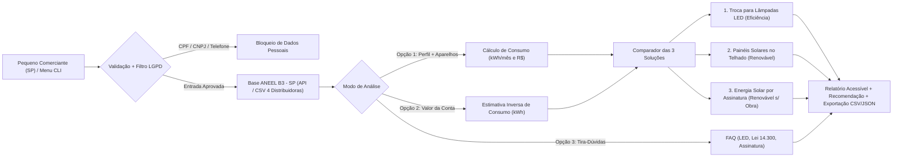

# Citizen Assist AI — Soluções em Energias Renováveis e Sustentáveis

| Item | Detalhes |
|---|---|
| **Disciplina** | Soluções em Energias Renováveis e Sustentáveis — FIAP (2026.2) |
| **Turma** | `1CCPJ` (Modalidade: Dupla) |
| **Integrantes** | Gustavo de Souza Correa (`RM570746`) e Arthur Tae Gun Yong (`RM570647`) |
| **Recorte** | Pequenos Comerciantes de São Paulo (SP) — Diagnóstico B3 e 3 Soluções Energéticas com Dados da ANEEL |
| **Linguagem** | Python 3 (`main.py`, `aneel_api.py`, `base_dados.py`, `calculos.py`, `assistente.py` e `testes_usuarios.py`) |

## Fluxo do Sistema



## Base de Dados (SP), Origem e Consumo de Referência (`base_dados.py` e `aneel_api.py`)

- **Público e Necessidade Real:** Pequenos comércios do estado de São Paulo (mercadinhos, padarias/lanchonetes e salões) enquadrados no **Subgrupo B3 (Comercial Baixa Tensão)** sofrem com contas altas por refrigeração 24h, ar-condicionado e iluminação antiga, precisando saber quanto gastam e qual solução escolher conforme tenham imóvel próprio ou alugado.
- **Dados Reais/Públicos (SP) vs. Estimados:**
  - **Reais/Regulatórios:** Tarifas B3 Convencionais da API de Dados Abertos da **ANEEL** para as 4 principais distribuidoras de SP (`data/tarifas_aneel_b3.csv`: Enel SP `R$ 0,7894/kWh`, CPFL Paulista `R$ 0,7395/kWh`, EDP SP `R$ 0,8017/kWh`, Elektro `R$ 0,8916/kWh` s/ impostos), Irradiação Solar de SP/Sudeste do **Atlas Solar INPE 2017** (`5,06 kWh/m²/dia`), Fator de Emissão do SIN do **MCTI 2024** (`0,0545 kg CO₂/kWh`) e Custo de Disponibilidade da **REN ANEEL nº 1.000/2021** (`30/50/100 kWh`).
  - **Estimados (Justificados):** Fator médio de tributos ICMS+PIS/COFINS (`× 1,30` → Enel SP final = `R$ 1,0262/kWh`), *Performance Ratio* solar (`0,78`), custo instalado (`R$ 4.000/kWp`, módulos `550 W`), impacto do Fio B da **Lei nº 14.300/2022** (`17%`), desconto de assinatura solar (`15%`) e potências/tempos médios de uso comercial (`26 dias/mês` geral e `30 dias × 16h efetivas/dia` para compressores de freezer).

| Equipamento (Caso Base: Mercadinho SP — Enel SP) | Qtd | Potência (W) | Uso (h/dia × dias) | Consumo (kWh/mês) | Custo Atual (R$/mês) | Origem da Potência |
|---|---:|---:|---|---:|---:|---|
| Freezer / expositor refrigerado | `3` | `320 W` | `16h × 30d` | `460,8 kWh` | `R$ 472,87` | INMETRO - PBE (Estimado) |
| Ar-condicionado Split 12.000 BTU | `1` | `1.100 W` | `8h × 26d` | `228,8 kWh` | `R$ 234,79` | INMETRO - PBE (Estimado) |
| Lâmpada fluorescente 40 W + reator | `12` | `48 W` | `12h × 26d` | `179,7 kWh` | `R$ 184,42` | INMETRO - PBE (Estimado) |
| Computador do caixa (PDV) + impressora | `1` | `150 W` | `12h × 26d` | `46,8 kWh` | `R$ 48,03` | Etiqueta típica (Estimado) |
| **TOTAL MENSAL / ANUAL** | — | — | — | **`916,1 kWh/mês`** (`10.993 kWh/ano`) | **`R$ 940,11/mês`** (`R$ 11.281,30/ano`) | Emissão: `~599 kg CO₂/ano` |

## Comparação das 3 Soluções, Cálculos, Limitações e Testes

- **Equações Fundamentais (`calculos.py`):**
  - **Consumo Mensal:** `E (kWh) = [P (W) × N × t (h/dia) × D (dias)] / 1000`
  - **Custo Mensal c/ Tributos:** `Custo (R$) = E (kWh) × Tarifa_ANEEL × 1,30`
  - **Dimensionamento Solar (SP):** `E_comp = E_mês - E_mín` e `P (kWp) = teto[ E_comp / (5,06 × 30 × 0,78 × 0,55) ] × 0,55`
  - **Retorno Simples (Payback):** `Payback (meses) = Investimento Inicial / Economia Mensal`
  - **Emissões Evitadas:** `CO₂ evitado (kg/ano) = Economia_anual (kWh) × 0,0545 kg CO₂/kWh`

| Solução Avaliada (Mercadinho SP — `916,1 kWh/mês`) | Renovável? | Investimento | Economia Mensal / Anual | Nova Conta | Retorno (*Payback*) | CO₂ Evitado/Ano | Viabilidade e Indicação |
|---|:---:|---:|---:|---:|---|---:|---|
| **0. Cenário Base (Atual)** | Não | `R$ 0,00` | `R$ 0,00` (`0%`) | `R$ 940,11` | — | *(Emite `599 kg`)* | Situação atual sem intervenção. |
| **1. Troca das Lâmpadas para LED** *(12× 48W → 18W)* | Não | `R$ 420,00` | `R$ 115,26/mês` (`12%`) / `R$ 1.383/ano` | `R$ 824,85` | **`3,6 meses`** | `73 kg CO₂` | **Passo 1 imediato** para qualquer comércio (baixo custo e retorno rápido). |
| **2. Painéis Solares no Telhado** *(`7,15 kWp`, 13 placas, ~39 m²)* | **Sim** | `R$ 28.600,00` | **`R$ 695,12/mês` (`74%`)** / `R$ 8.341/ano` | **`R$ 244,99`** | `41 meses` (`~3,4 anos`) | **`534 kg CO₂`** | **Imóvel próprio** com telhado livre de sombra e capital ou financiamento. |
| **3. Energia Solar por Assinatura** *(15% desc. s/ obra)* | **Sim** | **`R$ 0,00`** | `R$ 125,62/mês` (`13%`) / `R$ 1.507/ano` | `R$ 814,49` | **Imediato** | **`534 kg CO₂`** | **Imóvel alugado** ou comerciante sem capital inicial disponível. |

- **Limitações Explícitas ao Usuário:** Os valores são estimativas e não ganhos garantidos (variam com alíquota de ICMS, bandeiras tarifárias, taxa de iluminação pública, sombreamento do telhado, custo de disponibilidade da REN 1.000/2021 e Fio B da Lei 14.300/2022).
- **Testes Automatizados e Testes com Usuários (`testes_usuarios.py` — 100% aprovados):**
  - **`TU-01` (Mercadinho SP, Enel SP, imóvel próprio):** Sem dinheiro para placas solares de imediato → destacada a troca para **LED** como Passo 1 (`R$ 420`, retorno em `3,6 meses`).
  - **`TU-02` (Salão em Campinas, CPFL Paulista, imóvel alugado):** Proibido de fazer obra no telhado e dúvida em `kWh`/`kWp` → recomendação automática da **Solar por Assinatura** (`imovel_proprio=False`) e glossário simples.
  - **`TU-03` (Padaria no ABC Paulista, só sabia o valor da conta):** Desconhecia potência dos aparelhos → criada a **Simulação pela conta de luz** (`Opção 2`) e exibição da tarifa com e sem impostos.
  - **`TU-04` (Lanchonete em SJC, EDP SP, privacidade):** Receio de digitar CNPJ/telefone → filtro LGPD (`contem_dado_pessoal`) que bloqueia CPF, CNPJ, telefone e e-mail.

## Referências Verificáveis

- **ANEEL (Dados Abertos — Tarifas B3):** <https://dadosabertos.aneel.gov.br/dataset/tarifas-distribuidoras-energia-eletrica>
- **ANEEL (REN nº 1.000/2021):** <https://www2.aneel.gov.br/cedoc/ren20211000.html>
- **Marco Legal da GD (Lei nº 14.300/2022):** <https://www.planalto.gov.br/ccivil_03/_ato2019-2022/2022/lei/l14300.htm>
- **INPE / LABREN (Atlas Brasileiro de Energia Solar, 2ª ed.):** <https://labren.ccst.inpe.br/atlas_2017.html>
- **INMETRO (Tabelas PBE / PROCEL):** <https://www.gov.br/inmetro/pt-br/assuntos/avaliacao-da-conformidade/programa-brasileiro-de-etiquetagem/tabelas-de-eficiencia-energetica>
- **MCTI / SIRENE (Fatores de Emissão de CO₂ do SIN):** <https://www.gov.br/mcti/pt-br/acompanhe-o-mcti/sirene/dados-e-ferramentas/fatores-de-emissao>

## Como Executar no Terminal

1. Abra o terminal na pasta do projeto (`C:\Users\Gusta\Documents\trabalhosGS2\solucoes_energia`).
2. Para iniciar o **menu interativo** (opções `0` a `6`) ou a **demonstração imediata**:
   ```bash
   python main.py
   python main.py --demo
   ```
3. Para rodar a **bateria automatizada de testes e registros com usuários**:
   ```bash
   python testes_usuarios.py
   ```
